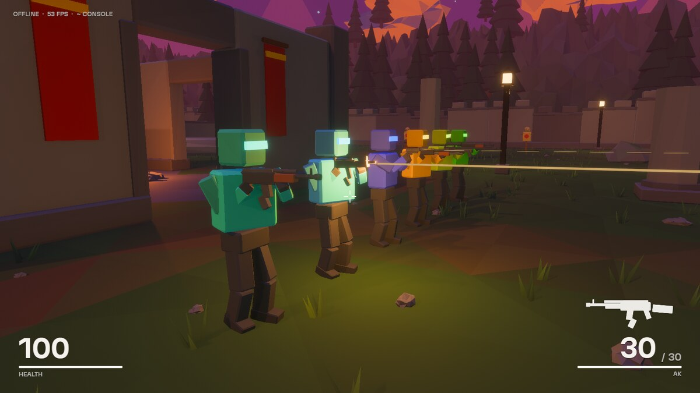
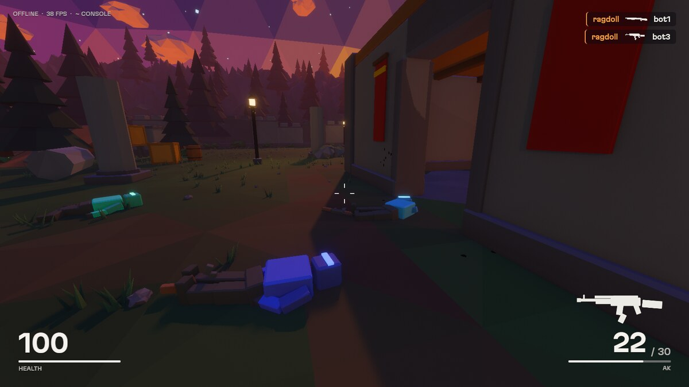

# fast-fps

Low-poly LAN shooter and game boilerplate with spray patterns, ragdolls, and a scripted test harness.



A small first-person shooter in [Bevy](https://bevyengine.org/) 0.20, built to be copied and
turned into your own game. There are no menus. Everything runs from the `~` console, and the
same console is how the tests drive the game, which makes it a good fit for working with AI
coding agents.

## Features

- **Five guns** with fixed, learnable spray patterns, and a crosshair that shows your real accuracy
- **Animated players** with no keyframes: legs and arms are solved in code with inverse kinematics
- **Ragdolls** built from the exact pose a player died in
- **LAN multiplayer** with one-command hosting and automatic server discovery
- **Practice bots** you can order around from the console
- **A test harness** that scripts the real game and reports PASS or FAIL
- **One command to start a new game** from this one, under its own name
- **No asset pipeline**: the map, guns, bodies and sounds are generated from code

## Install

### Requirements

- Rust (stable), from [rustup](https://rustup.rs/)
- Linux with Wayland or X11 and a Vulkan driver. Windows and macOS are untested.
- On Arch: `base-devel alsa-lib systemd-libs wayland libxkbcommon vulkan-icd-loader`, plus
  `vulkan-intel`, `vulkan-radeon` or `nvidia-utils` for your GPU
- For the test harness: `sway`. `imagemagick` is optional.

### From source

```sh
git clone https://github.com/slastra/fast-fps
cd fast-fps
cargo run
```

The first build compiles the engine and takes a while. After that it is quick.

## Usage

Click to grab the mouse. WASD to move, Space to jump (hold at a ledge to climb), Ctrl or C to
crouch, left click to fire, right click to scope (sniper), R to reload, 1-5 or the wheel to
switch weapons, Q for the last weapon, Tab for scores, Esc to release the mouse.

For something to shoot at, press `~` and type `exec cfg/bots.cfg`.

To play on a LAN, one machine hosts and the others join. Press `~`, then:

```
host                    listens on UDP 27015 and announces itself on the LAN
connect                 joins the first server found
connect 192.168.1.20    or name it
```

Launch arguments are console commands too: `cargo run -- +name alice +host`.
[docs/console.md](docs/console.md) lists every command.

## Configuration

`name`, `sens` (mouse sensitivity) and `fov` are saved when you set them in the console. They
live in `~/.config/fast-fps/config.cfg`, which is a list of console commands run at startup.

Game rules are constants in the source:

- `src/config.rs`: health, run speed, jump height, gravity, ports
- `src/weapon/defs.rs`: the guns and their spray patterns
- `src/world/arena.rs`: the map

## Make your own game

```sh
scripts/new-game.sh ~/Projects/Rust/space-arena
```

That makes a complete, working copy under a new name. It gets its own window title, settings
folder and network protocol, so it can never join a game of the original by accident. The
three files under Configuration change a game's character the most.

## How it works

**Weapons.** Spraying works like Counter-Strike. Each automatic weapon follows a fixed
pattern, the view kicks along half of it, and you pull the mouse down against it to stay on
target. On top of that is a random cone that grows when you move, jump or spray and shrinks
when you crouch. The crosshair gap is that cone, drawn to scale. The sniper is only accurate
scoped and standing still.

| | Fire | Mag | Damage (head) |
|---|---|---|---|
| AK | auto, 600 rpm | 30 | 34 (136) |
| MP5 | auto, 800 rpm | 30 | 24 (72) |
| Glock | semi | 20 | 22 (70) |
| Shotgun | pump | 8 | 9 x 17 (27) |
| Sniper | bolt | 5 | 115 (230) |

**Animation.** Other players are a jointed skeleton animated in code. Feet follow a stride
cycle and legs are solved to them, so walking, strafing, backpedaling and crouch-walking come
from one piece of code. Arms are solved to the gun's grips, so hands stay on the weapon at any
aim angle.

**Ragdolls.** A kill builds a physics copy of the body in the pose it died in and throws it
the way the shot was going. The gun drops separately.



**Networking.** One machine is the authority for damage, score and spawning, and the same
code runs offline. Each player simulates their own movement and reports it. That trusts
clients, which is fine for a LAN.

[docs/tour.md](docs/tour.md) maps the code and follows one shot through it.

## Development

```sh
scripts/check.sh --quick     # format, lint, unit tests, and a smoke test of the real game
scripts/check.sh             # everything, including every scripted scenario
```

| | |
|---|---|
| [AGENTS.md](AGENTS.md) | Start here, especially if you are an AI agent: commands, rules, traps. |
| [docs/tour.md](docs/tour.md) | A map of the code. |
| [docs/recipes.md](docs/recipes.md) | Step-by-step: add a weapon, change the map, add a command, sync a value. |
| [docs/harness.md](docs/harness.md) | The test harness: scripting the game and checking what it does. |

## Credits

The look follows Jan Hohenheim's [Foxtrot](https://github.com/janhohenheim/foxtrot) demo.
Movement is his [bevy_ahoy](https://github.com/janhohenheim/bevy_ahoy), physics is
[Avian](https://github.com/Jondolf/avian), and networking is
[bevy_replicon](https://github.com/simgine/bevy_replicon) over renet. Night Sky HDRI 001 by
ambientCG, CC0. Project structure started from
[bevy_new_2d](https://github.com/TheBevyFlock/bevy_new_2d).

## License

MIT © 2026 Shaun Lastra. See [LICENSE](LICENSE).
